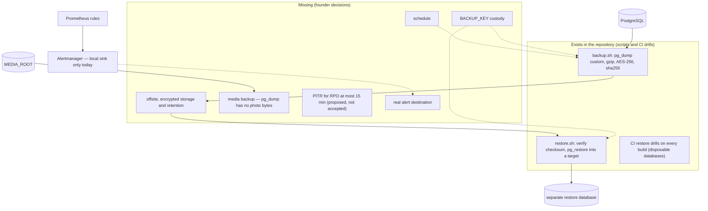

# Backup, restore and operational dependencies

What exists versus what a production-like environment would still need.
Facts: [BACKUP-RESTORE](../production/BACKUP-RESTORE.md),
[PRODUCTION-READINESS](../production/PRODUCTION-READINESS.md).

Private alpha: synthetic data, so recovery means recreate
([STAGING-RUNBOOK §9](../production/STAGING-RUNBOOK.md#9-reset-and-recreate-alpha)).
No RPO or RTO is claimed for it.
