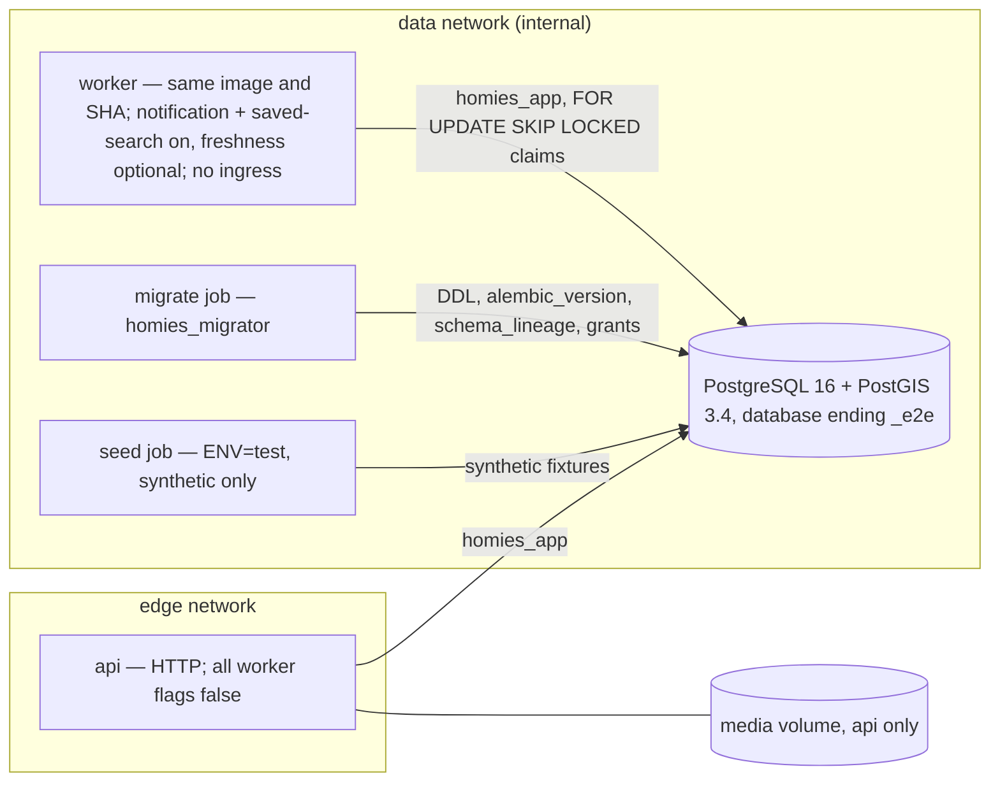

# Database and worker topology (private alpha, PROPOSED)

The workers run inside the API process through the FastAPI lifespan
([composition.py](../../backend/app/composition.py)); "worker" below is a second
instance of the same image with the worker flags on and no ingress.

| Role | Who connects | Can | Cannot |
|---|---|---|---|
| bootstrap superuser | DBA, once | run the role scripts | — (never used by the app) |
| `homies_migrator` | migrate job | own and change the schema; write lineage | serve requests |
| `homies_app` | api, worker, seed | DML on application tables | DDL, writing the schema record, UPDATE/DELETE append-only tables |

Source: [RELEASE-AND-MIGRATION §7](../production/RELEASE-AND-MIGRATION.md#7-roles).
