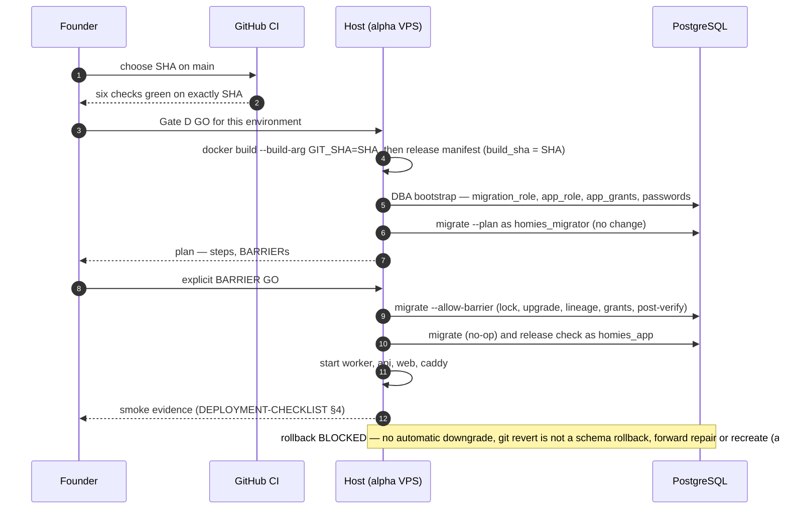

# Release and migration sequence (PROPOSED, not executed)

Policy: [RELEASE-AND-MIGRATION](../production/RELEASE-AND-MIGRATION.md).
Procedure: [STAGING-RUNBOOK §4–§8](../production/STAGING-RUNBOOK.md).

