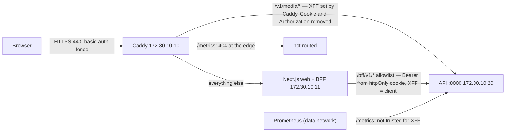
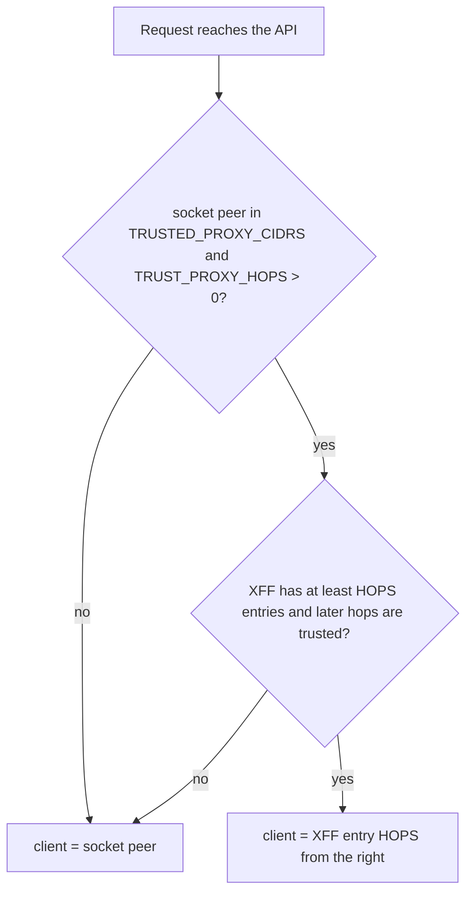

# Request flow and reverse-proxy trust (private alpha, PROPOSED)

Design, not a running system. Detail:
[STAGING-ARCHITECTURE §3, §5](../production/STAGING-ARCHITECTURE.md#3-proxy-trust-and-client-ip).

Trusted peers: exactly Caddy and web (`/32` each). Never the Docker
gateway, the whole subnet, the worker or Prometheus. Source:
[ratelimit.py `client_ip`](../../backend/app/core/ratelimit.py),
[client-ip.ts](../../frontend/web/src/server/client-ip.ts).
